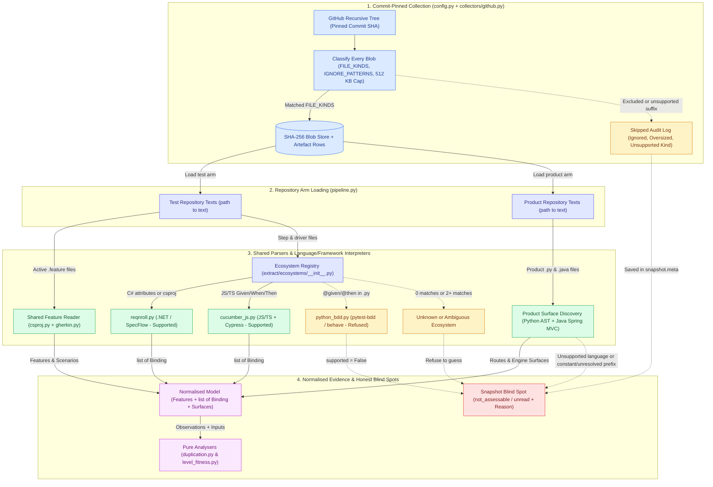
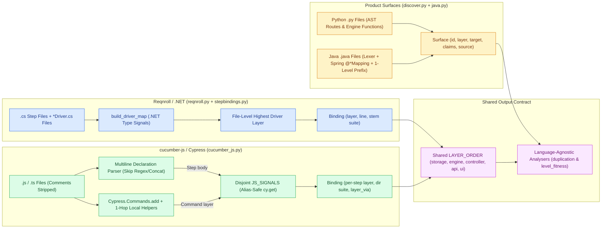
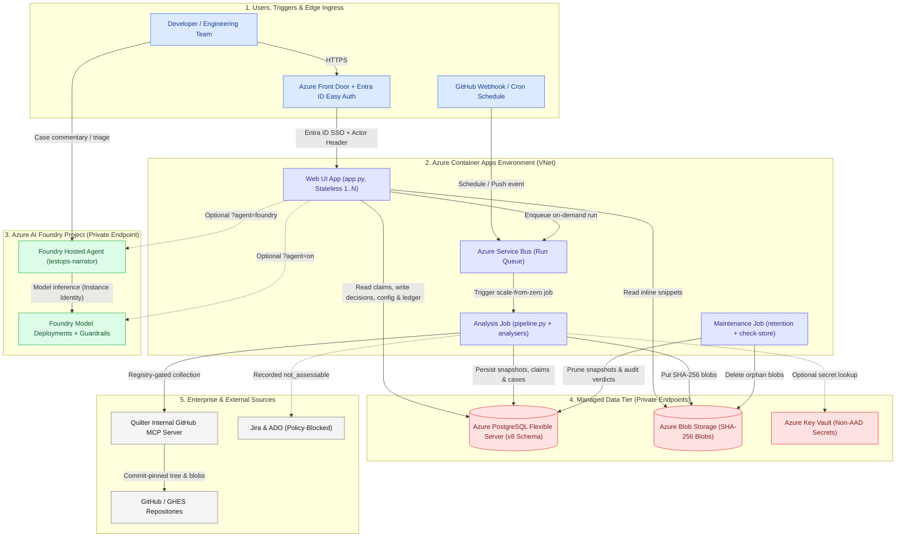
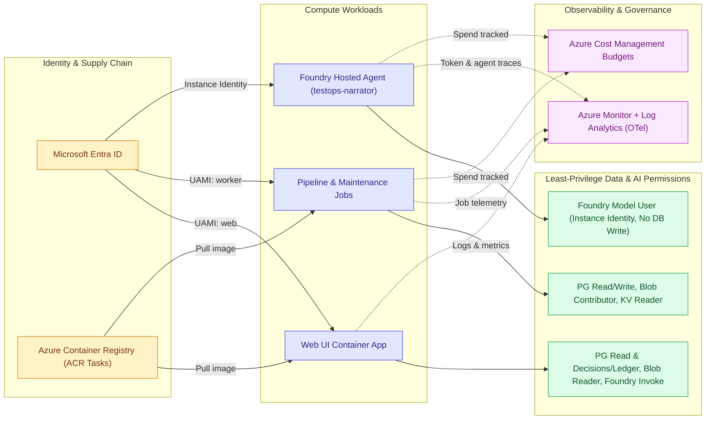

# TestOps

**Evidence-backed analysis of a repository pair.**

TestOps reads a **product repository** and its **behavioural test repository** and reports what the tests actually establish, at what architectural layer, and what they claim without proving. Its output is a **case**: one claim tied to an exact file, line, and commit, the code evidence behind it, what could not be checked, and a proposed action a team can accept or reject.

> **What TestOps is not:** It is not a test runner, a code-coverage percentage, or a code-quality linter. It does not judge whether a test is *correct* — it judges what level of interaction an assertion needs, whether the test reaches that level, and whether a cheaper layer or product surface already settles it. See [PRODUCT.md](PRODUCT.md).

---

## Core Architectural Invariants

Four rules govern every part of TestOps (see [AGENTS.md](AGENTS.md)):

1. **The store is the product's memory.** Analysis writes into SQLite and a content-addressed blob store; every web page and offline rebuild reads strictly from stored rows and blobs, never from a live source at read time.
2. **A missing source is never a zero.** Policy-blocked trackers (Jira/ADO), unconfigured repositories, unsupported file extensions, and unsupported test ecosystems produce explicit `not_assessable` / `blocked` / `absent` / `unsupported` records — never a silent `0`.
3. **Immutable snapshots, append-only evidence.** Re-running an analysis creates a new snapshot (bumping IDs on collision) rather than mutating historical evidence. Human decisions are recorded as append-only events with reversible suppressions.
4. **No credentials in git, logs, tickets, or the database.** Service settings actively reject credential field names, known token prefixes, and high-entropy blobs; runtime secrets resolve from the environment.

---

## Verdicts at a Glance

Every analysed assertion receives one verdict from the database-enforced vocabulary ([testops/store/schema.sql](testops/store/schema.sql), [testops/web/tone.py](testops/web/tone.py)):

| Verdict | Reader Headline | Tone | Raises a Case? | Meaning |
|---|---|---|---|---|
| `distinct` | Checked | Settled | No | Instrument is adequate and no browser was bought unnecessarily. |
| `review` | Checked, but over-tested for what it asserts | Alarm | Yes | A browser ran for a claim the HTTP response or served markup settles. |
| `repeats_product` | Checked, but the product already exposes this | Alarm | Yes | A browser was spent on a claim already exposed by a discovered product route/surface. |
| `gap` | Not proved — nothing runs a browser | Alarm | Yes | Assertion requires browser/accessibility checks, but no browser ran. |
| `duplicate` | Checked, but this repeats another test | Alarm | Yes | Identical scenario steps & data already established at a cheaper or equal layer. |
| `unplaced` | Cannot tell | Soft | No | Words name no comparison/settleable claim, or step could not be tied to a layer. |

---

## Quick Start

### Prerequisites & Install
TestOps requires **Python 3.11+** and has **zero third-party runtime dependencies** (standard library only; see [pyproject.toml](pyproject.toml)).

```bash
python3 -m venv .venv
.venv/bin/pip install -e ".[dev]"
```

### Running Locally

```bash
# Serve the local zero-JS web UI (default: http://127.0.0.1:8787)
python -m testops.cli serve --host 127.0.0.1 --port 8787

# Run deterministic analyses against a configured project slug (requires GITHUB_PAT in .env)
python -m testops.cli levels --project cotw
python -m testops.cli duplicate --project reqoverflow

# Inspect runs and cases, or record a human decision
python -m testops.cli runs --project cotw
python -m testops.cli cases --project cotw
python -m testops.cli case-set <case_id> --state resolved --actor <name> --note "Fixed in PR #42"

# Store maintenance & integrity checks
python -m testops.cli check-store
python -m testops.cli retention                   # footprint report only
python -m testops.cli retention --prune --keep 3 --yes
python -m testops.cli scrub-fixtures --dry-run
```

By default, runtime data lives in `data/testops.db` and `data/blobs/` (overridable via `TESTOPS_DATA` and `TESTOPS_ENV`).

### Running the Test Suite
Per [AGENTS.md](AGENTS.md) and [tests/README.md](tests/README.md), always run pytest from the project `.venv` with inherited Python environment variables stripped:

```bash
env -u PYTHONPATH -u PYTHONHOME -u VIRTUAL_ENV -u CONDA_PREFIX PYTHONNOUSERSITE=1 \
  .venv/bin/python -m pytest -q

# Fast lane (skips the ~20s wheel-build/install distribution test)
env -u PYTHONPATH -u PYTHONHOME -u VIRTUAL_ENV -u CONDA_PREFIX PYTHONNOUSERSITE=1 \
  .venv/bin/python -m pytest -q -m "not distribution"
```

All tests run offline against disposable temporary stores; a guard in [tests/conftest.py](tests/conftest.py) fails any test that attempts to open `data/testops.db` for writing.

---

## Guided Tour of the Repository

The repository is organised into **five zones**:

| Zone | Paths | Purpose |
|---|---|---|
| **1. Product Package** | `testops/` | Zero-dependency Python application: CLI, web UI, collectors, extractors, surface discovery, pure analysers, optional narrator client, and SQLite/blob storage. |
| **2. Hosted Foundry Agent & Container** | `Dockerfile`, `.dockerignore`, `agents/narrator/`, `scripts/deploy_azure.sh` | Container image build (ACR Tasks), Container Apps deployment script, and the `testops-narrator` hosted Azure AI Foundry agent. |
| **3. Tests & Page Contracts** | `tests/`, `tests/contracts/`, `tests/fixtures/` | ~80 invariant/unit test suites, real-repo fixtures (`reqoverflow`, pre-migration DBs), and a blind black-box HTTP/HTML contract suite running on an isolated port-0 child server. |
| **4. Governance, Docs & Factory** | `AGENTS.md`, `PRODUCT.md`, `ROLES.md`, `docs/`, `factory/` | Multi-agent factory rules, ADRs ([docs/ADR-1-projects-and-services.md](docs/ADR-1-projects-and-services.md)), ecosystem inventories, tickets, prompts, and build/review/deploy reports. |
| **5. Probes, Dev Scripts & CI** | `scripts/`, `tools/`, `.github/workflows/ci.yml`, `hello/`, `cost_probe.py` | CI pipeline (including the no-identifiers scan), exploratory inspection scripts, diagram generators, and the cost probe. |

### Inside `testops/`

- **Entrypoints & Orchestration**
  - [testops/cli.py](testops/cli.py) — Thin CLI wrapping all pipeline, query, decision, server, and maintenance operations.
  - [testops/pipeline.py](testops/pipeline.py) — End-to-end write path (`run_duplication`, `run_level_fitness`): resolve project/services → collect via registry → snapshot & artefacts → extract & discover surfaces → analyse → persist v2 claims & unsuppressed cases.
  - [testops/rebuild.py](testops/rebuild.py) — Offline replay that reproduces a `level_fitness` claim set strictly from a stored snapshot and its blobs with zero network I/O.
- **Configuration, Identity & Policy**
  - [testops/config.py](testops/config.py) — Dynamic `TESTOPS_DATA`/`TESTOPS_ENV` settings, `.env` loader, and declarative `FILE_KINDS` (`.csproj`, `.feature`, `.py`, `.cs`, `.ts`, `.js`, `.java`), ignore patterns, and 512 KB cap.
  - [testops/services.py](testops/services.py) — ADR-1 project & service CRUD (`git_repo`, `jira_board`, `ado_pipeline`), per-service availability assessment, and `validate_settings()` secret rejection.
  - [testops/sources.py](testops/sources.py) — Capability-based `Registry` (`code`, `test_code`, `requirements`, `test_execution`) enforcing `available` / `absent` / `blocked` states and per-capability readings.
- **Collectors (`testops/collectors/`)**
  - [http.py](testops/collectors/http.py) — Retrying `urllib` HTTP client.
  - [github.py](testops/collectors/github.py) — Commit-pinned recursive GitHub tree/blob collector that audits every skipped file by reason (`ignore pattern`, `unsupported kind`, `size cap`).
  - [jira.py](testops/collectors/jira.py) — Raw Jira issue JSON collector (only invoked if declared available; policy-blocked at Quilter).
- **Extraction & Surface Discovery (`testops/extract/`, `testops/surfaces/`)**
  - [extract/csproj.py](testops/extract/csproj.py) — MSBuild `<ReqnrollFeatureFile Remove="...">` exclusion filter.
  - [extract/gherkin.py](testops/extract/gherkin.py) — Line-numbered Gherkin parser (features, scenarios, outlines/examples, tables, doc strings, normalised signatures).
  - [extract/stepbindings.py](testops/extract/stepbindings.py) — Shared `Binding` dataclass, `LAYER_ORDER`, pattern-to-regex matcher, and .NET driver/signal inference.
  - [extract/ecosystems/](testops/extract/ecosystems/__init__.py) — Plug-in ecosystem registry with [reqnroll.py](testops/extract/ecosystems/reqnroll.py), [cucumber_js.py](testops/extract/ecosystems/cucumber_js.py), and [python_bdd.py](testops/extract/ecosystems/python_bdd.py).
  - [surfaces/discover.py](testops/surfaces/discover.py) & [surfaces/java.py](testops/surfaces/java.py) — Product surface discovery for Python (AST routes/engine functions) and Java (lexed Spring MVC `@*Mapping` routes with 1-level superclass/interface prefix resolution).
- **Analysers, Narrator & Scoring (`testops/analysers/`, `testops/judgement/`, `testops/score/`)**
  - [analysers/__init__.py](testops/analysers/__init__.py) & [base.py](testops/analysers/base.py) — Analyser registry, `Claim`/`Evidence` models, and per-analyser decision `COVER` contracts.
  - [analysers/duplication.py](testops/analysers/duplication.py) & [analysers/level_fitness.py](testops/analysers/level_fitness.py) — Pure, deterministic (zero-LLM) analysers.
  - [judgement/agent.py](testops/judgement/agent.py) & [judgement/client.py](testops/judgement/client.py) — Optional case-explanation commentary via direct Foundry model call (`?agent=on`) or hosted Foundry agent (`?agent=foundry`), with citation guard, 1-round repair, caching, and token/feedback ledger.
  - [score/level.py](testops/score/level.py) & [score/metrics.py](testops/score/metrics.py) — Held-out benchmark scorers.
- **Store, Read Models, Lifecycle & Web UI**
  - [store/schema.sql](testops/store/schema.sql), [db.py](testops/store/db.py), [migrate.py](testops/store/migrate.py), [verdicts.py](testops/store/verdicts.py) — Forward-only SQLite store (`schema_version = 8`) with provenance `CHECK` constraints, two-tier verdict triggers, and additive agent ledger tables.
  - [blobs.py](testops/blobs.py) — Content-addressed SHA-256 blob storage.
  - [queries.py](testops/queries.py), [links.py](testops/links.py), [cases.py](testops/cases.py), [retention.py](testops/retention.py), [scrub.py](testops/scrub.py) — Screen read models, exact-commit GitHub permalinks, human decision/suppression lifecycle, guarded retention pruning, and fixture scrubbing.
  - [web/app.py](testops/web/app.py), [web/tone.py](testops/web/tone.py), [web/lint.py](testops/web/lint.py) — Zero-JS server-rendered HTML UI (`/`, `/runs`, `/run/<id>`, `/case/<id>`, `/config`, `/agent-report`, `/agent-check`), verdict tone declarations, and plain-English HTML linter.

---

## How Code Is Read & Interpreted Across Languages

Repository code enters TestOps in **four stages**. Language- and framework-specific parsing is isolated inside `testops/extract/ecosystems/` (for test repos) and `testops/surfaces/` (for product repos), converging into one normalised model so the analysers stay completely language-agnostic.

### 1. End-to-End Ingestion & Ecosystem Dispatch



### 2. Inside the Supported Interpreters

Different frameworks express architectural layers in completely different ways: .NET separates drivers into classes per file, Cypress/JS mixes UI and API custom commands inside one file, and Spring Boot declares HTTP routes across class/interface inheritance hierarchies. Each interpreter uses its own isolated vocabulary and parser, then emits the shared `Binding` or `Surface` contract.



### 3. The Normalised Model

Every interpreter converges onto **three core dataclasses** and **one shared layer scale**:

1. **Behavioural Specification (`Feature` → `Scenario` → `Step` in [testops/extract/gherkin.py](testops/extract/gherkin.py)):**
   - Captures what the tests claim: scenario names, 1-based line numbers, tags, steps (`Given`/`When`/`Then`/`And`/`But`), data tables, doc strings, and outline examples.
   - `Scenario.signature` normalises wording and formatting while **preserving digits and table/example data** so distinct test cases never falsely collide.
2. **Executable Step Plumbing (`Binding` in [testops/extract/stepbindings.py](testops/extract/stepbindings.py)):**
   - Captures what architectural layer each step definition actually reaches on one shared cost ladder:
     `storage < engine < controller < api < ui` (or `unknown`).
   - Carries `verb`, `pattern`, `path`, 1-based `line`, `suite`, plus optional call-graph provenance (`layer_via`, `layer_reason`, `layer_commands`) for ecosystems like `cucumber-js`.
3. **Product Capabilities (`Surface` & `Discovery` in [testops/surfaces/discover.py](testops/surfaces/discover.py)):**
   - Captures what the product itself exposes (`id`, `layer`, `target`, `claims`, `source`), alongside explicit `state` (`found` / `zero` / `not_assessable`), `unread` mappings, and `inherited_prefixes`.

Before running any analyser, [testops/pipeline.py](testops/pipeline.py) persists every `Scenario` and `Binding` into the SQLite `observation` table and hands the pure analysers a `support_index` mapping `(path, verb, pattern) -> observation_id`. That keeps the analysers 100% database-free while ensuring every emitted `Claim` links back to exact stored observations and line-numbered snippets.

### 4. Interpreter Reference Table

| Interpreter | Target Arm & Files | Status | How It Detects & Interprets | Honesty / Refusal Behaviour |
|---|---|---|---|---|
| [reqnroll.py](testops/extract/ecosystems/reqnroll.py) + [stepbindings.py](testops/extract/stepbindings.py) | Test arm (`.cs`, `.csproj`) | **Supported** | Matches `[Given/When/Then("...")]` attributes; maps `*Driver` bodies via `.NET` type signals (`IPage`, `HttpClient`, `IMediator`, `DbContext`) to file-level layer. | Strips `namespace` lines so folder/namespace names never fake a layer. |
| [cucumber_js.py](testops/extract/ecosystems/cucumber_js.py) | Test arm (`.js`, `.ts`) | **Supported** | Parses multiline `Given/When/Then(...)` calls; follows `cy.<customCommand>()` and 1 hop of local helpers to disjoint `JS_SIGNALS` (`cy.get` selector vs. `cy.request`). | Records & skips regex-literal or concatenated patterns (`unreadable_declarations`); refuses dynamic `Step(this, ...)` delegation (`unknown` + reason). |
| [python_bdd.py](testops/extract/ecosystems/python_bdd.py) | Test arm (`.py`) | **Detect & Refuse** | Counts `@given`/`@when`/`@then` decorators in `pytest_bdd`/`behave` files. | Returns `supported=False` and raises `UnsupportedEcosystem` so Python suites are never misread by another parser. |
| [gherkin.py](testops/extract/gherkin.py) + [csproj.py](testops/extract/csproj.py) | Test arm (`.feature`, `.csproj`) | **Shared** | Filters MSBuild-excluded features; parses active scenarios, steps, tables, doc strings, and examples with exact line numbers. | Preserves digits & table rows in signatures; dormant features are counted separately, never analysed as active. |
| [discover.py](testops/surfaces/discover.py) + [java.py](testops/surfaces/java.py) | Product arm (`.py`, `.java`) | **Python & Java** | Python: AST routes & `/src/` engine functions. Java: custom lexer + Spring MVC `@*Mapping` annotations + 1-level superclass/interface `@RequestMapping` inheritance. | Non-literal Java paths (constants) and unreadable/ambiguous parent types are recorded in `unread` (never guessed as `/`); other languages report `not_assessable`. |

**Adding a new test framework** requires only two steps: ensure its file extension is listed in `FILE_KINDS` ([testops/config.py](testops/config.py)), and add an `EcosystemModule` under `testops/extract/ecosystems/` registered in `_shipped()`.

---

## Optional AI Narrator Commentary & Citation Guard

Deterministic rules in `duplication.py` and `level_fitness.py` produce every verdict (`model_calls = 0`). On top of that evidence, [testops/judgement/agent.py](testops/judgement/agent.py) offers **opt-in plain-English commentary** on any case page:

- **Three page variants:**
  - `?agent=off` (default) — deterministic evidence page only.
  - `?agent=on` — explanation generated via TestOps's direct Foundry model call (`deepseek-flash`).
  - `?agent=foundry` — explanation generated by the hosted Azure AI Foundry agent `testops-narrator` ([agents/narrator/main.py](agents/narrator/main.py)).
- **The verdict never changes:** Switching the agent on or off leaves the deterministic verdict above it byte-identical (verified by tests across real case pages).
- **Citation Guard + 1-Round Repair:** `case_record()` gives every stored fact an ID (e.g. `claim:2405`). The narrator must cite valid IDs for every sentence and agree with the cited rows (no invented routes, swapped HTTP verbs, or ungrounded numbers). A rejected reply gets one targeted repair pass; a second failure falls back honestly to the agent-off page with the reason.
- **Measured A/B Ledger:** Additive SQLite tables (`agent_view`, `agent_call`, `agent_explanation`, `agent_feedback`, `agent_flag`, `agent_token_probe`) cache explanations by `(case_id, prompt_hash, model)` and power two built-in operational screens:
  - `/agent-report` — compares `model-route` vs. `foundry-hosted-agent` side by side (views by state, rejections, cache hits, exact provider token counts, and *"This helped" / "This did not"* votes).
  - `/agent-check` — shows configured endpoints, model, whether a token is available (never its value), and token-free IMDS / `az` probe history.

---

## Azure & Azure AI Foundry Architecture

### What Runs Live on Azure & Foundry Today (Demo Deployment)

TestOps already ships a working cloud demo deployment documented in [factory/reports/2026-11-24/azure-deploy.md](factory/reports/2026-11-24/azure-deploy.md) and [agents/narrator/README.md](agents/narrator/README.md):

- **Container image:** [Dockerfile](Dockerfile) (`python:3.12-slim`, zero pip installs) built in the cloud via **ACR Tasks** (`scripts/deploy_azure.sh` → `az acr build` into `testopsdemo30562`) and deployed to **Azure Container Apps** (`rg-testops-demo` / `testops-env` / `testops`, `0.25 vCPU`, `0.5 Gi`, external ingress on port `8080`).
- **Foundry integration:** Connects to an Azure AI Foundry project named by `TESTOPS_FOUNDRY_ACCOUNT` and `TESTOPS_AGENT_PROJECT` (with the `deepseek-flash` deployment) directly (`?agent=on`) and via the hosted Responses v2 agent `testops-narrator` (`?agent=foundry`, deployed from `agents/narrator/`).
- **Key lessons discovered live in Azure (driving the production target below):**
  1. **SQLite over Azure Files (SMB) fails on schema migrations across warm revisions** (`database is locked`), so the demo currently serves a baked-in read-mostly store (decisions/votes reset on revision restart). Production requires managed PostgreSQL + Azure Blob Storage.
  2. **Container Apps IMDS (`169.254.169.254`) was unreachable** from the demo container (`Errno 111`), so `TESTOPS_AGENT_TOKEN` is supplied via a Container App secret rather than image/repo config.
  3. **Foundry Hosted Agent identity:** Inside the Foundry hosted runtime, `DefaultAzureCredential` resolves to the non-assignable blueprint identity (`PrincipalTypeNotSupported`). `agents/narrator/main.py` therefore mints tokens for the agent's *instance* identity (`FOUNDRY_AGENT_INSTANCE_CLIENT_ID`) via `$IDENTITY_ENDPOINT` with audience `https://ai.azure.com` and retries cold-start `401`s.

### Target Production Azure & Foundry Component Architecture

The target cloud-native architecture removes the single-replica SQLite and demo-auth limitations while preserving all four TestOps invariants. All data services and Foundry endpoints sit behind **Private Endpoints** inside a VNet.



### Identity, Least-Privilege RBAC & Platform Operations

Each workload receives its own identity so that **the Web UI cannot fetch external repos**, **workers cannot alter Entra auth**, and **the Foundry narrator agent cannot mutate verdicts or suppress findings**.



### Cloud Runtime Flows

```mermaid
sequenceDiagram
    actor Dev as Developer (Entra ID)
    participant Bus as Service Bus / Schedule
    participant Job as Container Apps Job (Pipeline)
    participant MCP as Quilter GitHub MCP
    participant Blob as Azure Blob Storage
    participant PG as Azure PostgreSQL
    participant Web as Web UI (Container App)
    participant Foundry as Azure AI Foundry (Narrator)

    rect rgb(238, 242, 255)
        note over Bus,PG: 1. Deterministic Analysis Run (Scale-from-Zero Worker, Zero LLM Spend)
        Bus->>Job: Trigger run(project_slug, analyser)
        Job->>PG: Load project & services
        Job->>Job: Build sources.Registry (GitHub available; Jira & ADO policy-blocked)
        Job->>MCP: Fetch commit-pinned test & product trees/blobs
        MCP-->>Job: File contents + skipped/unsupported counts
        Job->>Blob: Put raw files keyed by SHA-256 (deduplicated)
        Job->>Job: Detect ecosystem, parse Gherkin & bindings, discover Python/Java surfaces, run pure analyser
        Job->>PG: Persist immutable snapshot, artefacts, observations, guarded v2 claims & unsuppressed cases
    end

    rect rgb(240, 253, 244)
        note over Dev,Foundry: 2. Authenticated Web Review, Optional Guarded Commentary & Reversible Decision
        Dev->>Web: GET /case/:id (optional ?agent=on or ?agent=foundry)
        Web->>PG: Query claim, observations, product surface & snapshot blind spots
        Web->>Blob: Fetch test & product blobs for inline snippets
        opt Commentary Requested & Cache Miss
            Web->>Foundry: Send grounded case_record(ids) to model or testops-narrator
            Foundry-->>Web: Cited prose + exact USAGE token counts
            Web->>Web: Citation guard (verify IDs & facts; 1 repair round on violation; fallback on 2nd fail)
            Web->>PG: Cache explanation & record agent_call / agent_view ledger rows
        end
        Web-->>Dev: Render deterministic verdict + optional labelled commentary + feedback links
        Dev->>Web: POST /case/:id/state (resolved | false_positive | needs_fix | open) + CSRF token
        Web->>PG: Append case_state(actor=X-MS-CLIENT-PRINCIPAL-NAME) & update suppression
        Web-->>Dev: 303 Redirect to /case/:id
    end
```

### Current-to-Production Azure Component Mapping

| Component | Current State (Demo / Local) | Production Azure Target | Remaining Seam / Work Needed |
|---|---|---|---|
| **Web UI** ([testops/web/app.py](testops/web/app.py), [Dockerfile](Dockerfile)) | Live on Container Apps (`ThreadingHTTPServer`, 1 replica, public URL, actor `"harry"`). | Stateless Container App (1..N) behind Front Door + Entra ID Easy Auth. | WSGI/Gunicorn wrapper, `/healthz`, read actor from `X-MS-CLIENT-PRINCIPAL-NAME`, CSRF protection. |
| **Evidence Store** ([testops/store/](testops/store/schema.sql)) | SQLite `v8` baked into demo image (SMB mount failed lock on migration). | **Azure Database for PostgreSQL Flexible Server** (Entra ID auth). | Thin storage dialect layer porting `CHECK` constraints and `verdict_vocabulary` triggers. |
| **Blob Store** ([testops/blobs.py](testops/blobs.py)) | Local `data/blobs/<sha256>` directory. | **Azure Blob Storage** (private container keyed by SHA-256). | Route `retention.py` blob listing/deletion through `blobs.py` and add Azure Blob backend. |
| **Analysis Pipeline** ([testops/pipeline.py](testops/pipeline.py)) | CLI-triggered locally (`load_env()` reads `.env` file). | **Azure Container Apps Jobs** (Service Bus / Cron). | Merge `os.environ` in `config.load_env()`; add job trigger entrypoint. |
| **GitHub Collector** ([testops/collectors/github.py](testops/collectors/github.py)) | Direct GitHub REST API with `GITHUB_PAT`. | **Quilter Internal GitHub MCP Collector** (behind [sources.py](testops/sources.py)). | Implement MCP transport collector preserving `Skipped` and per-capability `Reading` records. |
| **Narrator Commentary** ([testops/judgement/agent.py](testops/judgement/agent.py), [agents/narrator/](agents/narrator/main.py)) | Live on Foundry (`deepseek-flash` + hosted `testops-narrator`, citation guard & ledger). | Same Foundry project behind Private Endpoint with Key Vault / UAMI auth. | Resolve Container Apps managed identity endpoint (use `IDENTITY_ENDPOINT` alongside IMDS). |

---

## Contributing & The Factory Rule

Before editing anything in this repository, read [AGENTS.md](AGENTS.md) and [ROLES.md](ROLES.md):

- **Product code in `testops/` changes only through factory tickets** tracked in [factory/TICKETS.md](factory/TICKETS.md) (built in isolated worktrees, verified with build & review reports, and gated by observable evidence).
- Documentation (`README.md`, `PRODUCT.md`, `ROLES.md`, `docs/**`) and `factory/**` artefacts may be maintained directly by the Lead.
